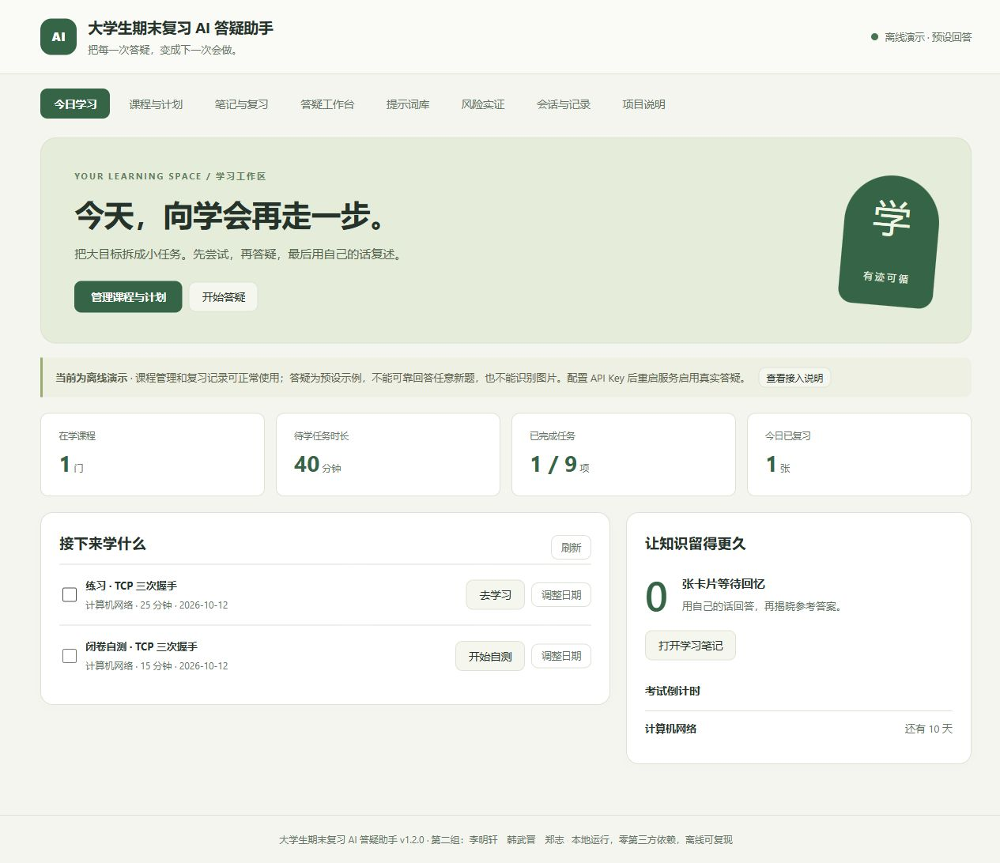

# 大学生期末复习 AI 答疑助手

> 把每一次答疑，变成下一次会做。

一个面向大学生期末复习的**个人本地学习工作区**。从考试目标到今天的任务，从答疑到错因记录，
再到下次闭卷回忆，让复习有计划、学习有记录。Python 3.10+，运行时零第三方依赖。

当前版本 **v1.2.0**：

- **今日学习**：待学任务、待复习卡片、考试倒计时与真实的任务完成数量。
- **课程与计划**：自己的考纲、考试日期、每日时间预算；可执行任务、完成/撤销、调整日期、自定义任务、归档/恢复。
- **笔记与复习**：回答一键存卡片、个人错因、手工卡片、搜索与课程筛选；先回忆再揭晓，按自评安排下次复习。
- **连续答疑**：课程背景、历史问答上下文、刷新后恢复会话、草稿保存、失败保留问题与附件。
- **可解释的数据**：离线演示与降级标记跟随回答保存；格式检查不当作正确率；学习数据可导出为 JSON。

先试一次：[学习工作区使用指南](docs/学习工作区.md)。现有六大模块、提示词库、CLI 与风险评测继续保留。



**没有 API Key 时，答疑只是预设演示，不能可靠回答任意新题或识别图片。**
课程管理、任务排程、手工笔记与复习提醒可完整离线使用；接入真实模型后，问题、上下文与图片会发送到对应服务。
本应用默认只监听本机，适合个人学习；尚不提供公网多用户登录、云同步或客观掌握度评估。

### 第一次使用

```powershell
git clone https://github.com/erichan111111/ai-tutor.git
cd ai-tutor
python -m ai_tutor web --open
```

打开页面后，添加课程 → 安排复习任务 → 从任务进入答疑 → 把回答存为卡片 → 在「笔记与复习」先回忆再揭晓。
需要真实答疑时，按下方说明配置模型密钥并重启服务。

### 开发验证

```powershell
python -X utf8 -m unittest discover -s tests -p "test_*.py" -v
python -X utf8 -m ai_tutor selftest
python -X utf8 tests/smoke_test.py
```

新增测试覆盖数据库重启、预算与考试容量、重复/并发排程、任务撤销、归档恢复、回答来源、自评间隔、完整导出和 HTTP 链路。
GitHub Actions 在 Python 3.10 和 3.14 上运行以上离线检查，不需要模型密钥。

v1.1.0 的历史能力（在 v1.2.0 中保留）：

| 变更 | 说明 |
| --- | --- |
| **接入 DeepSeek** | 默认模型 `deepseek-flash`（DeepSeek-V4.1-Flash）；Key 不入库，通过环境变量 `DEEPSEEK_API_KEY` 或本地 `config.json` 提供 |
| **支持图片输入** | 上传 / 拖拽 / 粘贴题目照片、截图、手写演算，自动走视觉模型识别后按模块解析 |
| **移除提示词模式开关** | 应用对外**只使用精细提示**；原"粗放 vs 精细"对照退化为评测层的内部消融机制（前端无感） |

```text
阶段一  选题调研 → 六大复习痛点 → 系统能力与能力边界
阶段二  六大功能模块（M1–M6）+ 精细提示词库
阶段三  四类专项风险实证 + 多工具横向对比 + 提示词消融对照
本仓库  把以上全部实现为「CLI + Web + REST API + 评测框架 + 本地数据库」
```

---

## 一、30 秒上手

零第三方依赖，**不需要安装任何包**。

```bash
cd ai-tutor

# 0) 配置 DeepSeek Key（本仓库不含任何真实密钥）
#    Windows PowerShell（当前窗口有效）
$env:DEEPSEEK_API_KEY = "sk-你的密钥"
#    或永久生效：setx DEEPSEEK_API_KEY "sk-你的密钥"
#    或复制模板后填写：copy config.example.json config.json
#    不配置也能跑：所有能力会自动降级到内置离线模型

# 1) 一键自检（走内置离线模型：可复现、不消耗额度；44 项检查）
python -m ai_tutor selftest

# 2) 启动 Web 界面（推荐）——支持提问 + 图片上传
python -m ai_tutor web --open          # http://127.0.0.1:8848

# 3) 命令行提问（支持图片）
python -m ai_tutor ask "帮我解这道题：lim(x→0) (sin x - x) / x³" --show-prompt
python -m ai_tutor ask "识别图片里的题目并解析" -i 题目.png -i 演算过程.jpg

# 4) 交互式对话（:image 附加图片、:clear 清空）
python -m ai_tutor chat

# 5) 阶段三风险实证（默认用 deepseek，加 --model mock 可走离线）
python -m ai_tutor risk run --kind all

# 6) 生成汇报用图解（8 张 PNG + Excel 记录表 + 图文报告）
python -m ai_tutor report assets --mode auto

# 7) 导出全部交付文档（提示词库 / 模块说明 / 风险方案 / 用例集）
python -m ai_tutor export all
```

> **自检默认走内置离线模型**，保证结果可复现、不消耗额度；
> 要用真实模型自检：`python -m ai_tutor selftest --online`。
> 任何远端调用失败都会自动降级到离线演示，并在结果里标注 `degraded` 与原因；演示回答不代表真实解题结果。

### 更新到 GitHub

本仓库已发布在 <https://github.com/erichan111111/ai-tutor>。

```bash
# 方式一：已安装 git
git add -A && git commit -m "说明这次改了什么" && git push

# 方式二：没有 git，用 gh CLI 通过 API 推送（本机就是这种情况）
python tools/github_push.py --repo ai-tutor --push-only --message "说明这次改了什么"
```

> `tools/github_push.py` 会跳过 `.gitignore` 列出的内容（密钥、数据库、评测中间产物），
> 推送前打印文件清单与体积，可先用 `--dry-run` 预览。

---

## 二、项目结构

```text
D:\project
├── ai_tutor/                     # 应用主包（零第三方依赖）
│   ├── config.py                 # 配置加载（config.json + 环境变量覆盖）
│   ├── storage.py                # SQLite 持久化：会话/轮次/产出物/风险记录/评测批次
│   ├── utils.py                  # 文本处理、重复度算法（2-gram/LCS/结构相似度）
│   ├── service.py                # 服务门面：CLI / Web / 评测三方共用同一套能力
│   ├── cli.py                    # 命令行界面
│   ├── webapp.py                 # Web 服务器（标准库 http.server）+ REST API
│   ├── selftest.py               # 一键自检（44 项，默认离线）
│   ├── deliverables.py           # 交付文档导出
│   ├── llm/                      # 模型接入层
│   │   ├── base.py               # 统一 ChatResult / ImagePart（多模态）/ 错误类型
│   │   ├── openai_compat.py      # OpenAI 兼容协议（DeepSeek/OpenAI/通义/智谱/Kimi/Ollama/vLLM）
│   │   ├── anthropic.py          # Claude 原生协议（含图片块）
│   │   ├── qianfan.py            # 百度千帆（文心一言）
│   │   ├── registry.py           # 提供方注册 + 视觉模型选择 + 失败自动降级
│   │   ├── router.py             # 任务路由（阶段三「工具路由」建议的代码化）
│   │   ├── mock.py               # 内置离线模型（严格按精细提示契约输出）
│   │   ├── kb.py                 # 学科知识库（极限/TCP/递归/幻觉与逻辑用例素材）
│   │   └── outlines.py           # 复习提纲的三种组织方式（反同质化演示）
│   ├── prompts/                  # 提示词库（阶段二核心交付物）
│   │   ├── schema.py             # 五要素框架、六种结构模式、ModuleSpec
│   │   ├── modules.py            # M1–M6 定义（精细提示模板原文）
│   │   └── __init__.py
│   ├── features/                 # 六大功能模块实现
│   │   ├── base.py               # 基类 + 图片装配 + 自动化质检 quality_check
│   │   ├── qa.py                 # M1 习题解析 / M2 知识框架
│   │   ├── diagnose.py           # M3 错题归纳 / M4 概念讲解
│   │   └── plan.py               # M5 薄弱检测与计划 / M6 口语陪练
│   ├── eval/                     # 阶段三风险实证框架
│   │   ├── cases.py              # H1–H6 / L1–L5 / T1 / 对比用例 + 判定器
│   │   ├── metrics.py            # 五维量化指标 + 达标判定
│   │   └── runner.py             # 四类测试执行器 + 报告生成
│   ├── report/                   # 汇报素材生成（图解 + Excel）
│   │   ├── canvas.py             # 中文字体 / HiDPI 画布 / 表格 / 柱状图 / 热力图
│   │   ├── data.py               # 采集测试数据（在线实测 / 历史批次 / 离线复现）
│   │   ├── figures.py            # 8 张图解的绘制实现
│   │   ├── workbook.py           # Excel 记录表（含原生图表与条件格式）
│   │   └── generate.py           # 生成入口 + Markdown 图文报告
│   └── web/                      # 前端（原生 HTML/CSS/JS，无框架无 CDN）
├── tests/smoke_test.py           # 核心链路冒烟测试
├── tests/fixtures/               # 测试用图片（题目样例）
├── tools/                        # 仓库维护脚本（PPT 抽取、GitHub 推送等）
├── deliverables/                 # 交付物：提示词库 / 风险实证图解 / Excel
├── docs/                         # 使用说明 / 架构说明 / 真实模型实测结果
├── data/                         # 运行时数据（SQLite + 报告；自动创建，不入库）
├── config.json                   # 本地配置：模型、图片限制、通过标准（api_key 留空）
├── config.example.json           # 配置模板（含环境变量说明），可复制为 config.json
├── requirements.txt              # 依赖说明（本应用不需要安装任何包）
└── README.md
```

---

## 三、六大功能模块（阶段二交付物）

每个模块一一对应阶段一提出的一个复习痛点，均由**独立的提示词**驱动。

| 模块 | 名称 | 对应痛点 | 结构约束 | 路由任务 |
| --- | --- | --- | --- | --- |
| M1 | 习题解析 | 解析难懂 | 六段式：题型判断 → 方法选择 → 分步求解 → 交叉验证 → 易错点 → 不确定标注 | `structured` |
| M2 | 知识框架生成 | 框架难理 | 七段式：四级分层 + 关联标注 + 考点星级 + 对比表 + 常见误区 + 深度控制 + 复习周期 | `structured` |
| M3 | 错题归纳 | 错题难归 | 七步诊断：错误定位 + 五分类 + 根因 + 关联知识 + 同类练习 + 预防措施 + 主动追问 | `logic` |
| M4 | 概念通俗讲解 | 概念难明 | 九段式：生活类比 + 技术定义 + 结构图解 + 代码注释 + 执行过程表 + 三要素 + 误区 + 争议标注 | `chinese_explain` |
| M5 | 薄弱检测与复习计划 | 弱点难辨 | 两阶段：先出 5 道诊断题 → 再生成按天计划（薄弱点 ≥40%、含模拟自测与达标标志） | `anti_repetition` |
| M6 | 口语背诵陪练 | 练习难伴 | 逐轮闭环：每轮一问 + 四维评分 + 先给范答再纠错 + 自适应难度 + 5 轮总结 | `chinese_explain` |

**设计方法论（五要素框架）**：精细提示 = 角色锁定 + 格式模板 + 质量红线 + 诚实边界 + 受众适配。

```bash
python -m ai_tutor modules                 # 查看六大模块
python -m ai_tutor prompt show M1          # 查看 M1 的精细提示原文
python -m ai_tutor prompt export prompts.md
```

### 图片输入（v1.1.0 新增）

```bash
python -m ai_tutor ask "识别图片里的题目并按模块解析" -i 题目.png
python -m ai_tutor ask "看看我的演算错在哪" -i 演算.jpg -i 题目.png   # 可多张
python -m ai_tutor ask "批改这些题" -i shots\        # 目录
python -m ai_tutor ask "..." -i "题目*.png"          # 通配符
```

Web 界面支持三种方式：**点击选择、拖拽到虚线框、Ctrl+V 直接粘贴截图**（最多 4 张，
单张 ≤ 8 MB，支持 png / jpg / jpeg / webp / gif，可在 `config.json` 调整）。

工作方式：请求带图片时自动切换到支持视觉的模型（当前为 `deepseek-flash`，
它同时支持文本与图片输入），并在提示词里追加**图片识别契约**——
先准确识别图中题目文字/公式/图表/手写演算，识别不清处必须写进【不确定标注】，
**禁止凭猜测补全题目条件**。

---

## 四、阶段三：四类风险实证

```bash
python -m ai_tutor risk list              # 列出全部用例
python -m ai_tutor risk show H2           # 查看单个用例（风险模式、合规信号）
python -m ai_tutor risk run --kind pair   # 事实幻觉 + 逻辑缺陷（含消融对照）
python -m ai_tutor risk run --kind repetition --rounds 3
python -m ai_tutor risk run --kind comparison --models deepseek openai anthropic qianfan
python -m ai_tutor risk run --kind all --model mock    # 全量离线跑（不消耗额度）
```

| 测试类型 | 用例 | 自动判定方式 |
| --- | --- | --- |
| 事实幻觉 | H1 教材例题数值 / H2 虚构 DOI / H3 不存在的政策条文 / H4 概念混淆 / H5 无来源精确数据 / H6 虚构页码 | 正则识别"编造模式"，并要求命中处处于**断言语境**且附近**无否定词**（避免把模型的纠错引用误判为幻觉） |
| 逻辑缺陷 | L1 极值充分性 / L2 单一归因 / L3 方向倒置 / L4 充要条件 / L5 连续与可导 | 核对正确结论关键词，并与风险模式联合判定 |
| 同质化 | T1 同一任务重复 3 次（+ 反同质化提示对照） | 两两平均相似度：2-gram Jaccard / LCS 占比 / 结构相似度 加权 |
| 多工具对比 | C1–C10（幻觉 5 + 逻辑 5） | 相同精细提示下按五维度汇总 |

**提示词消融对照**：由于应用对外只有精细提示，"对照"退化为评测层的内部机制——
同一道题分别用**精细提示**与**无约束提示**（只给角色，不给格式契约/红线/诚实边界）各跑一次，
用来量化"提示词结构本身"对风险缓解的贡献。它只在 `risk` 命令与 `selftest` 内部使用，
**界面与 API 都不暴露这个开关**。

**通过标准**：精细提示下 幻觉率 ≤20%、逻辑错误 ≤1 处、重复度 ≤30%。

每次测试都会把**提示词原文与输出原文完整落库**（`risk_interactions` / `turns`），
并生成 `data/reports/*.md` 与 `*.json`。

### 真实模型实测结论（DeepSeek deepseek-flash）

| 对照组 | 幻觉率 | 逻辑错误率 | 合规率 | 结构完整度 | 不确定标记 | 平均字数 |
| --- | --- | --- | --- | --- | --- | --- |
| 无约束提示（消融对照） | 33%（2/6） | 0% | 73% | 0.10 | 0.00 | 262 |
| **精细提示（正式使用）** | **0%** | 0% | **100%** | **0.72** | **0.77** | 2023 |

同质化：默认精细提示重复度 **31%**，加入反同质化约束后降到 **21%**。

**核心结论**：精细提示把幻觉率降到 0%、把结构完整度从 0.10 提到 0.72、把主动的不确定标记
从 0.00 提到 0.77——提示词工程的主要价值是「让输出**可预期、可复用、可信赖**」，
而不是「让模型变聪明」（该模型在逻辑推导上本身已很稳健，两版逻辑错误率均为 0%）。
完整数据、与阶段三汇报的差异说明、以及联调中修复的工程问题见
[docs/真实模型实测结果.md](docs/真实模型实测结果.md)。

---

## 五、模型与图片识别

**默认提供方为 DeepSeek**（默认模型 `deepseek-flash`）。密钥不写进仓库，按下面任一方式提供：
环境变量 `DEEPSEEK_API_KEY`（推荐），或把 `config.example.json` 复制为 `config.json` 后填
`llm.models.deepseek.api_key`。两者都缺省时自动降级到内置离线模型。切换或新增提供方：

| 提供方 | `provider` 名 | 视觉 | 环境变量 |
| --- | --- | --- | --- |
| DeepSeek（默认） | `deepseek` | ✓（deepseek-flash 支持图片） | `DEEPSEEK_API_KEY` |
| OpenAI（GPT-4o） | `openai` | ✓ | `OPENAI_API_KEY` |
| Anthropic（Claude 3.5） | `anthropic` | ✓ | `ANTHROPIC_API_KEY` |
| 百度千帆（文心一言） | `qianfan` | — | `QIANFAN_API_KEY` + `QIANFAN_SECRET_KEY` |
| 通义千问 | `dashscope` | — | `DASHSCOPE_API_KEY` |
| 智谱 GLM | `zhipu` | — | `ZHIPU_API_KEY` |
| 本地 Ollama | `ollama` | 视模型而定 | — |

```bash
python -m ai_tutor models                  # 列出模型：可用性 + 是否支持图片
python -m ai_tutor ask "..." --model openai
set AI_TUTOR_MODEL=deepseek                # 或用环境变量指定默认模型
```

**任务路由**（阶段三改进建议 4 的落地）：`--router` 会按任务类型自动选模型——
事实核查 → Claude（幻觉率最低），结构化提纲 → GPT-4o（结构最完整），
中文口语化讲解 → 文心一言。查看路由表：

```bash
python -m ai_tutor routes
```

任何远端调用失败（网络、鉴权、限流）都会**自动降级到内置离线模型**，
并在结果中标记 `degraded=true` 与降级原因，保证应用永远可用。

---

## 六、Web 界面与 REST API

```bash
python -m ai_tutor web --host 127.0.0.1 --port 8848 --open
```

主界面首先提供今日学习、课程与计划、笔记与复习，详见 [学习工作区指南](docs/学习工作区.md)。同时保留以下能力视图：

1. **答疑工作台** —— 选择模块、选择模型、开启任务路由；**图片区支持点击选择 /
   拖拽 / Ctrl+V 粘贴**，发送后缩略图保留在对话里；每次回答都展示质检指标
   （结构完整度 / 不确定标记 / 教学价值 / 结构覆盖率）与可展开的提示词原文。
   —— 界面上**没有提示词模式开关**，提问即按对应模块的精细提示执行。
2. **提示词库** —— 五要素方法论表、六种结构模式、六大模块的精细提示原文。
3. **风险实证** —— 四个按钮一键执行四类测试，实时展示量化对比表、关键发现与改进建议。
4. **会话与记录** —— 会话回看（含每轮提示词与输出）、评测批次列表、运行报告。
5. **项目说明** —— 三阶段要点、运行状态、图片识别模型、路由表、命令行入口。

REST API（返回 JSON，可被其它前端或脚本复用）：

```text
GET  /api/health              GET  /api/models          GET  /api/routes
GET  /api/modules             GET  /api/prompts         GET  /api/detect?q=
GET  /api/sessions            GET  /api/session/{id}    GET  /api/evals
GET  /api/risk/records        GET  /api/report
POST /api/ask                 POST /api/risk            POST /api/session
POST /api/ablate              # 提示词消融对照（评测层，界面不暴露）
```

示例（纯文本）：

```bash
curl -X POST http://127.0.0.1:8848/api/ask \
  -H "Content-Type: application/json" \
  -d "{\"question\":\"帮我解释一下递归是什么\",\"module\":\"M4\"}"
```

示例（带图片，`images` 支持本地路径或 data URI）：

```bash
curl -X POST http://127.0.0.1:8848/api/ask \
  -H "Content-Type: application/json" \
  -d "{\"question\":\"识别图片中的题目\",\"module\":\"M1\",\"images\":[\"D:/project/tests/fixtures/题目样例.png\"]}"
```

---

## 七、数据与报告

| 数据表 | 内容 |
| --- | --- |
| `sessions` | 会话（标题、模块、模型、元信息） |
| `turns` | 每一轮：模块、**提示词原文**、**输出原文**、提供方/模型、耗时、token、是否降级、是否图片、质检指标 |
| `artifacts` | 产出物（复习提纲、复习计划、陪练报告） |
| `risk_interactions` | 风险测试逐条记录：用例编号、提示词条件、输出原文、命中的风险模式 |
| `eval_runs` | 评测批次：类型、配置、量化指标、报告文件路径 |

```bash
python -m ai_tutor report --out data/report.md   # 生成运行报告
```

---

## 八、自动化质检说明（重要）

`ai_tutor/features/base.py::quality_check` 是**规则化近似**评分，用于批量筛选与对照实验：

- **结构完整度**：模块要求的段落标题是否全部出现（同义标题做退化匹配）+ 是否含表格与编号步骤
- **不确定标记**：是否出现「未核实 / 无法确认 / 有争议 / 超纲」等诚实边界声明
- **教学价值**：是否含表格、代码、足够篇幅
- **红线落实**：按模块结构逐条检查（如「含交叉验证」「含考点星级」「先诊断」「每轮一问」）

它**不能替代人工评价**：涉及教材页码、文献 DOI、政策条文的输出仍必须人工复核并标注「待核实」。

另外，模型有时**以 JSON 形式返回答案**（实测 DeepSeek 在 JSON 模式下常见）。
程序会自动把它还原成【段落名】分段文本用于展示与质检，原始 JSON 完整保留在
`turns.structured` 中，不会丢信息。

---

## 九、常见问题

**Q：需要自己配 Key 吗？**
A：需要自己配一次（仓库里不放密钥）。二选一：
`$env:DEEPSEEK_API_KEY = "sk-..."`（环境变量，优先级最高、推荐），
或把 `config.example.json` 复制为 `config.json` 并填写 `deepseek.api_key`。
配置后默认模型 `deepseek-flash` 同时支持文本与图片输入；**不配也能跑**（自动用离线模型）。

**Q：没有网络/Key 时能用吗？**
A：能。内置离线模型完整实现六个模块、四类风险测试、图片上传链路与全部指标计算，
所有输出标记 `simulated=true`。离线模型**不会假装识别图片**，而是如实说明无法识别图片内容，
并列出已接收的图片元信息——这本身就是"拒绝编造"契约的体现。

**Q：为什么 `selftest` 不用真实模型？**
A：为了让自检**可复现且不消耗额度**。自检走内置离线模型；要跑真实模型：
`python -m ai_tutor selftest --online`。

**Q：图片识别用的哪个模型？**
A：`deepseek-flash`（DeepSeek-V4.1-Flash），官方模型列表里 `input_modalities` 为
`["text","image"]`。请求带图片时程序会自动选用支持视觉的模型；若换成不支持图片的模型，
会在结果里明确提示而不是静默失败。

**Q：提示词模式开关去哪了？**
A：v1.1.0 起应用只使用精细提示，界面上不再有"粗放/精细"切换，用户无感。
原来的对照实验改成评测层的**提示词消融机制**（精细提示 vs 无约束提示），
只在 `risk` 命令、`ablate` 命令与 `selftest` 内部使用，用于量化提示词结构的贡献。

**Q：端口被占用怎么办？**
A：`python -m ai_tutor web --port 9000`。

**Q：数据想重置？**
A：删除 `data/` 目录即可（下次运行自动重建）。

---

## 十、依赖说明

**运行时零第三方依赖**，仅使用 Python 标准库（3.10+，开发环境为 3.12）。
`requirements.txt` 中不包含任何运行时依赖，`python-pptx` 等仅用于 `tools/` 下的
汇报材料内容抽取脚本（可选）。
